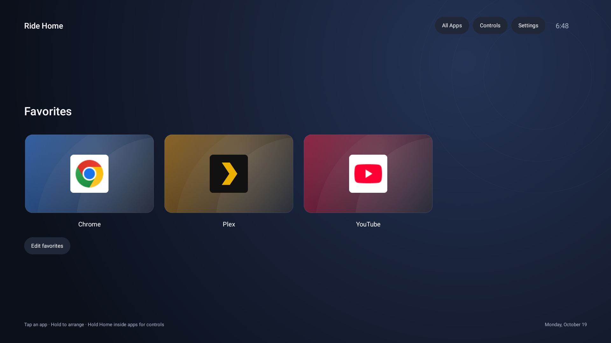

# Ride Home

A quiet, touch-first Android launcher with a reliable way back home.

Built for a touchscreen exercise bike: large app tiles, a static favorites screen,
and a small **Home** tab that stays within reach inside other apps. No feed, ads,
account, analytics, network permission, or runtime libraries.

> **Status:** early developer release. Tested on a SoulCycle SH-1 running Android 9
> at 1920 × 1080. Other Android devices are experimental. This project is independent
> of SoulCycle and Equinox and does not unlock paid classes or subscriptions.



## How it feels

- **Tap an app** to open it, with a brief pressed animation.
- **Hold a favorite** to move it left/right, replace it, remove it, or open App info.
- **Edit favorites** offers the same controls without a long press. A fresh install
  starts with an Add a favorite tile; no apps are selected for you.
- **All Apps** keeps the complete launchable app list one tap away.
- **Tap Home** inside another app to return to Favorites.
- **Drag Home** to either edge. Its position survives a restart.
- **Hold Home** for Back, Home, Recent Apps, Settings, and media volume. The tray
  dismisses after an action, tapping outside, Close, or eight seconds of inactivity.
- The floating tab stays hidden on Ride Home itself. Use its **Controls** button.

[See the on-demand control tray](docs/controls.png). Example apps are manually
selected for these screenshots; see [third-party notices](THIRD_PARTY_NOTICES.md).

## Build

Requirements: macOS or Linux, Bash, Python 3, JDK 17, and the Android SDK with
**platform 35** and **build tools 35.0.0**. No Gradle, Maven, or downloaded app libraries.

```sh
sdkmanager "platforms;android-35" "build-tools;35.0.0"
export ANDROID_SDK_ROOT="/path/to/your/android-sdk"
./scripts/test.sh
./build.sh
```

The APK is `dist/RideHome-debug.apk`. Building does not install or publish anything.
A local developer signing key is generated at `build/debug.p12`; keep it private and
back it up outside Git. To update an existing installation, build with its original
key: `RIDEHOME_DEBUG_KEYSTORE=/path/to/existing-key.p12 ./build.sh` (alias `ridehome`,
local developer password `android`). A signing mismatch must not be resolved by
silently uninstalling the app or clearing its data.

This repository does not yet provide a maintainer-signed APK or automatic updates.
The generated developer APK is intended for local testing, not an official release.

## Install safely

Keep your current launcher installed until you have tested Ride Home.

```sh
adb devices -l
# Replace SERIAL with the intended tablet; do not target another connected device.
adb -s SERIAL install -r dist/RideHome-debug.apk
adb -s SERIAL shell am start -n nyc.arash.ridehome/.Home
```

1. Open **Settings → Accessibility → Ride Home navigation** and enable it. This
   supplies the Home tab and system Back/Recent Apps actions.
2. Add favorite apps and verify that tapping and holding Home work inside an app.
3. Select Ride Home in Android's default Home app settings when ready. Ride Home's
   **Settings → Default home app** opens that screen.

Some newer Android versions require **Allow restricted settings** in App info for
sideloaded accessibility services. Menu names vary. Root and a bootloader unlock are
not required. Ride Home does not enable ADB or bypass a locked tablet.

**Recovery:** use **Settings → Default home app** to select your previous launcher.
Disable Ride Home navigation in Android Accessibility settings to remove the tab.
See [installation and recovery](docs/installation.md) for ADB alternatives.

## Privacy, compatibility, and limits

The accessibility service draws its own controls and invokes Android global actions.
It does **not** subscribe to accessibility events, retrieve screen content, inspect
windows, capture keys, or intercept gestures. The app requests no Android permissions;
Android separately authorizes the accessibility service in Settings. Favorites and tab
position are stored locally. Read the [privacy statement](PRIVACY.md).

Minimum Android API 23 (Android 6); target API 28 is intentional for the Android 9
appliance currently tested. Compilation against SDK 35 does not imply Android 15
compatibility. Protected screens and some vendor policies can suppress overlays.
The Home tab occupies 108 × 52 dp and overlays content; move it if it covers controls.
The UI is designed for landscape tablets, not phones or TV remotes.

App icons are read from installed apps at runtime; their brands and subscriptions
remain their owners'. Ride Home does not bundle those apps, stream content itself,
restore Android system navigation, or control bike resistance/firmware.

## Contributing

See [CONTRIBUTING.md](CONTRIBUTING.md) for validation and
[docs/testing.md](docs/testing.md) for device checks and current evidence.
Please keep issues free of private ride data, account details, signing keys, and ADB
serial numbers. Report security concerns using [SECURITY.md](SECURITY.md).

[MIT licensed](LICENSE). The launcher and icon are original project code, not a fork
of dumbtv. That project prompted the initial discussion; no dumbtv source is included.
